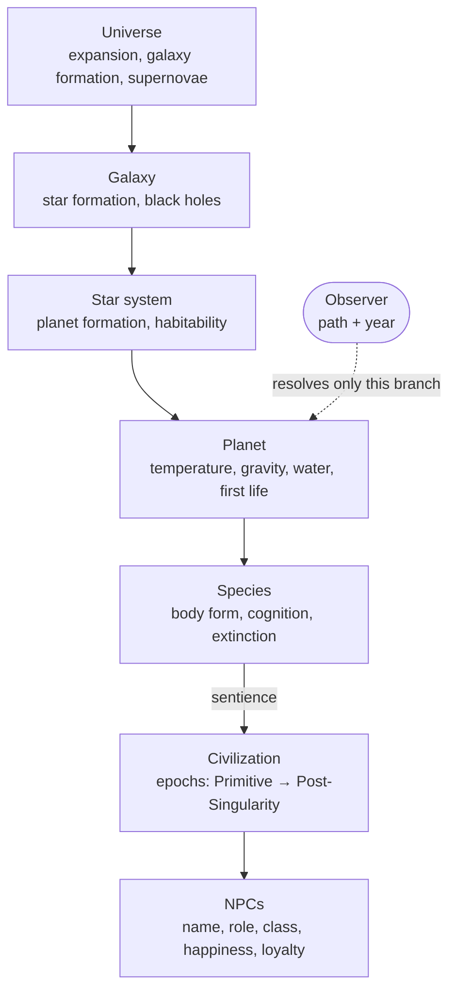

# NinjaVerse.Core

**An observational universe simulator.** The universe isn't simulated all at once. It is worked out where and when you look.

Pick a path (galaxy → star system → planet → civilization) and a point in time. NinjaVerse runs a nested chain of seeded simulators down that path and returns what an observer would find: a galaxy's star formation history, a planet's climate, a species that evolved (or went extinct) there, and the rise of its civilization through to its individual people. With the same seed and the same path you always get the same universe.

> **Status: parked concept / prototype (April 2025).** The architecture and simulator chain exist, but each level is still simple placeholder rules and the observer layer isn't wired up yet. See [Roadmap](#roadmap).

## The idea

- **Everything is a `SimEntity`:** a type, a seed, a bag of traits and a timeline of historical events.
- **Each level has an `ITemporalSimulator`** that advances an entity by N years and records what happened.
- **The observer** (`ObserverContext`, `SimulationStore`) addresses entities by path and year (`galaxy-star-planet-civ-Y{year}`) and caches what has been observed, so the universe only becomes concrete where someone looks.

The core is a plain C# library with no engine dependencies, so it can be dropped into Unity, Godot (.NET) or a console app.

## Repository layout

| Folder | What it is |
| --- | --- |
| `NinjaVerse.Core/` | The engine-agnostic simulation library (.NET Framework 4.7.2) |
| `NinjaVerse.Core/Modules/` | One simulator per level: Universe, Galaxy, StarSystem, Planet, Species, Civilization, NPC |
| `NinjaVerse.Core/Observer/` | Observation context and entity cache |
| `NinjaVerse.App/` | Console demo: a universe, then a planet's species, then a civilization, with printed timelines |
| `NinjaVerse.Unity/` | Unity 6 (6000.0.38f1) test project using the built DLL from `Assets/Plugins/` |

## Running it

- **Console:** open `NinjaVerse.App/NinjaVerse.App.csproj` in Visual Studio or Rider, which pulls in `NinjaVerse.Core.csproj`, and run it. It prints the universe, planet and civilization timelines for a fixed seed.
- **Unity:** build `NinjaVerse.Core`, copy the DLL to `NinjaVerse.Unity/NinjaVerse.Unity/Assets/Plugins/`, open the project in Unity 6000.0.38f1 and use `SimulationManager` / `SimulationSetupUI`.

## Roadmap

Ideas for moving the concept forward:

1. **Define what an observation returns.** Observations should return render-ready parameters (galaxy shape and density, star temperature, planet albedo, atmosphere, ocean level, crater density, city lights) in an engine-neutral format, so any renderer or shader can visualize them.
2. **Make the simulation a function you can query:** state = f(seed, path, time). Derive child seeds by hashing the path, use hash-based randomness so results don't depend on observation order, use a coarser timescale at each higher level, and checkpoint long histories.
3. **Prove one zoom level visually.** Start with scrubbing a single planet through its whole history before building out the full hierarchy.
4. **Light travel time.** Distant objects are seen as they were in the past, which gives observation real meaning.
5. **History as content.** Expand coarse epochs into specific events (wars, migrations, first contact) when they are observed.
6. **Packaging.** Move to modern .NET and expose observations as JSON so non-C# engines and tools can use them too.

## License

[MIT](LICENSE)
